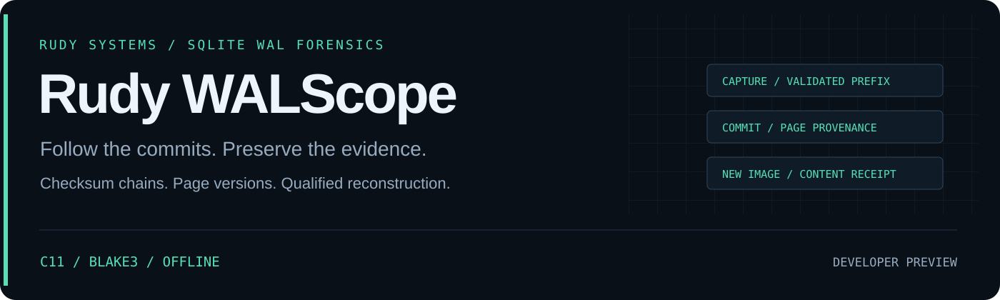

<p align="center"></p>

<p align="center">
  <a href="https://github.com/r4venrudy/rudy-walscope/actions/workflows/ci.yml"></a>
  
  <a href="LICENSE"></a>
  <a href="https://rudy.systems"></a>
</p>

**A SQLite database file can omit the latest committed state. Its WAL holds page versions, transaction boundaries, and an ordered checksum chain. WALScope makes that evidence reviewable without opening the source through SQLite.**

Rudy WALScope is a C11 offline SQLite write-ahead log investigation and committed-page reconstruction tool. It validates the current WAL prefix, indexes commit markers and page versions, compares selected snapshots, and reconstructs a new database image with a source receipt. Raw page bytes remain out of reports.

Developer preview · little- and big-endian WAL checksums · 512–65,536-byte SQLite pages · native Linux, Windows, and macOS binaries · no SQLite library or Python dependency at runtime.

## What you can investigate

| Question | Evidence |
| --- | --- |
| Which part of this capture validates? | Header and rolling frame checksums, salts, first invalid offset, excluded tail bytes, and whole-file BLAKE3 identity |
| Where are the commit boundaries? | Commit ordinals, first/last frame, database page count, and distinct pages written |
| What happened to one page? | Ordered versions, transaction membership, commit status, file offset, and page-content digest |
| What changed between commits? | Exact added/removed/modified page counts and both source versions; display limits do not alter totals |
| Can a selected committed image be reconstructed? | Latest eligible page versions, explicit base provenance, no pending-frame application, no zero filling, and no page resurrection across truncation |
| Can someone review it locally? | Versioned JSON, readable text, and expandable HTML with a commit timeline and page evidence |

**Base-state boundary:** the WAL does not authenticate which database it belongs to or prove when the base was checkpointed. A supplied base requires `--assume-pre-wal-base`, your assertion that it belongs to this WAL generation and predates its frames. An ordinary copied database/WAL pair may not satisfy that condition. Without a known base state, use inspection/page history, or recover only a WAL that contains every page of the selected image. See [acquisition and scope](docs/ACQUISITION.md).

## Install and run

Download a native archive from [Releases](https://github.com/r4venrudy/rudy-walscope/releases), verify `SHA256SUMS.txt`, and extract it. Use `bin/walscope` on Linux/macOS or `bin\walscope.exe` on Windows.

Packages contain controlled synthetic captures, expected SQL states, generated reports, an example recovered image, documentation, and dependency licenses. The synthetic example is invented test data; no user databases are included.

```sh
bin/walscope inspect examples/synthetic/capture.wal
bin/walscope inspect examples/synthetic/capture.wal --format html --output investigation.html
bin/walscope page examples/synthetic/capture.wal --page 2 --format json
```

Reconstruct an earlier committed state from the **known pre-WAL synthetic base**:

```sh
bin/walscope recover examples/synthetic/capture.wal --base examples/synthetic/base.sqlite --assume-pre-wal-base --commit 2 --output recovered.sqlite --format json
```

Compare page bytes between two commits:

```sh
bin/walscope diff examples/synthetic/capture.wal --base examples/synthetic/base.sqlite --assume-pre-wal-base --from 1 --to latest --format json --fail-on changed
```

Recovery's `--output` is the database image; its receipt goes to standard output. For inspection, page history, and comparison, `--output` writes a report. Every output must be new: existing files, hard links, and symbolic links are refused. Recovery stages bytes in an exclusive sibling file, rechecks source digests, and only then creates the destination. POSIX output files use mode `0600`; Windows uses inherited directory ACLs and exclusive access while writing.

An exported image preserves its original page headers, including WAL-mode bytes. To query a **separate working copy** without sidecar writes, use a trusted SQLite reader in read-only immutable mode. The validation suite does this and checks both `PRAGMA integrity_check` and expected SQL rows. WALScope itself does not execute SQL or claim logical database integrity from checksums alone.

## Tail handling and exit codes

| Exit | Meaning |
| --- | --- |
| `0` | Completed within the declared scope; requested gate not reached |
| `1` | Requested `pending`/`changed` gate reached, or explicit prefix recovery/comparison accepted an excluded tail |
| `2` | Invalid/incomplete capture, unsupported input, resource budget, unstable input, or I/O error |

Inspection of a malformed tail emits a report with `complete: false` and exits `2`. A salt mismatch may be leftover data from an older WAL generation; a checksum mismatch alone does not identify its cause. Parsing stops at the first invalid frame and never searches later bytes for a plausible commit.

Valid but uncommitted frames are reported separately and never applied. `inspect --fail-on pending` returns `1` when they are present. To reconstruct or compare only a validated committed prefix after tail validation stops, explicitly add `--accept-tail`; the result keeps `complete: false` and returns `1`. This flag cannot bypass an invalid header, a resource limit, missing source pages, or an incompatible base.

## Build and test

Requirements: CMake 3.20+, a C11 compiler, and a build tool. Python 3.9+ with standard-library `sqlite3` enables the independent integration suite and synthetic fixture generator. It is not used by the native tool. The BLAKE3 C implementation is vendored, source-pinned, and checked by CMake; configuring and compiling download nothing.

```sh
cmake -S . -B build -DCMAKE_BUILD_TYPE=Release -DWALSCOPE_REQUIRE_PYTHON=ON
cmake --build build --config Release --parallel
ctest --test-dir build --build-config Release --output-on-failure
cmake --install build --config Release --prefix stage
```

The executable is `build/walscope` in a Unix single-configuration build or `build/Release/walscope.exe` with Visual Studio. The installed layout matches a native release package. Source checkouts exclude captures; create the controlled example in a **new directory**:

```sh
python examples/make_capture.py build/synthetic
```

Tests include 35 official BLAKE3 vectors in one-shot and segmented modes, both checksum byte orders, three page sizes, every selected real-SQLite commit, independent SQL-state and page-diff oracles, pending frames, stale/corrupt/partial tails, shrink/regrowth gaps, Unicode paths, limits, alias preservation, and staging cleanup. CI adds Linux GCC, Windows MSVC, macOS Clang, and Linux ASan/UBSan. Tagged packaging is gated by those checks and exercises installed binaries on each target OS.

## Resource limits

| Resource | Default | Ceiling |
| --- | --- | --- |
| Each input file | 512 MiB | 4 GiB via `--max-input-mib` |
| Validated frames | 200,000 | 1,000,000 via `--max-frames` |
| Each reconstructed/comparison image | 512 MiB | 2 GiB via `--max-output-mib` |
| Displayed rows per collection | 100 | 1,000 via `--rows` |
| Rendered report | 16 MiB | Fixed |

Page payloads are streamed; metadata and bounded page-source indexes are held in memory. Recovery requires temporary disk space for the staged image plus the destination. Whole-file BLAKE3 is checked before and after processing; inputs must still be stable offline copies. These application budgets are not an OS memory/time sandbox or a live acquisition/locking protocol.

## Design and evidence

- [Checksum chain, snapshots, and truncation barriers](docs/DESIGN.md)
- [Report contract and source provenance](docs/REPORTS.md)
- [Acquisition assumptions and interpretation](docs/ACQUISITION.md)
- [Validation and preview limits](docs/VALIDATION.md)
- [Synthetic scenario](examples/README.md)
- [Security boundaries](SECURITY.md) · [Dependency provenance](THIRD_PARTY.md) · [Contributing](CONTRIBUTING.md)

WALScope does not recover SQL rows from deleted/free pages, parse rollback journals or `-shm`, infer timestamps, attribute actions to users, decrypt databases, or authenticate capture provenance. Reconstructed images can contain sensitive database contents. Page hashes and valid checksums do not replace acquisition records or an independent database integrity check.

**RUDY Systems · SQLite WAL forensics** · [Project home](https://rudy.systems) · [MIT license](LICENSE)
